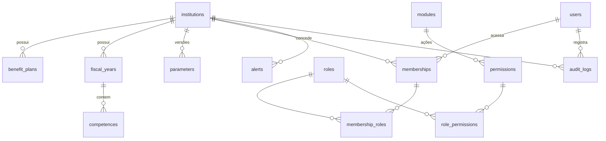

# SIST — Modelo de dados

Convenções: chaves UUID nas entidades de negócio; `created_at/updated_at/created_by/updated_by` em todas;
`institution_id` em toda entidade de negócio; valores monetários `NUMERIC(15,2)`; históricos com `valid_from/valid_to`;
registros referenciados nunca são excluídos (inativação ou nova versão).

## 1. Fase 1 (implementado)

| Tabela | Campos principais | Restrições |
|---|---|---|
| `institutions` | id, name, short_name, cnpj, ente_name, ente_cnpj, address, district, city, uf, cep, phone, email, website, active | short_name único; cnpj único |
| `benefit_plans` | id, institution_id, code, name, kind, description, legal_basis, start_date, active | (institution, code) único |
| `payroll_groups` | id, institution_id, segment (FINANCEIRO / PREVIDENCIARIO / COMPRA_VIDAS), code, name, plan_id, active | uma folha por massa; COMPRA_VIDAS aponta para o plano PREVIDENCIÁRIO |
| `life_purchases` | id, institution_id, number, cutoff_date, effective_date, legal_act, legal_act_date, actuarial_study, transferred_amount, lives_count, origin_plan_id, destination_plan_id, notes, active | (institution, number) único; sem exclusão |
| `actuarial_bases` | id, institution_id, reference_year, reference_month, layout_code, life_purchase_enabled, file, file_name, file_sha256, file_size, summary, pendencias, notes | histórico imutável de bases geradas |
| `fiscal_years` | id, institution_id, year, status, closed_at, closed_by, notes | (institution, year) único; 1990 ≤ year ≤ 2100 |
| `competences` | id, institution_id, fiscal_year_id, year, month, status, is_reference, closed_at, closed_by | (institution, year, month) único; uma referência por instituição |
| `parameters` | id, institution_id, key, value JSONB, description, version, valid_from, valid_to, change_reason | (institution, key, version) único |
| `users` | id, username, password (Argon2), full_name, cpf, email, phone, job_title, default_institution_id, failed_login_attempts, locked_until, must_change_password, password_changed_at, last_login_ip | username e cpf únicos |
| `modules` | code (PK), name, group, order, phase, implemented | sincronizado do catálogo |
| `permissions` | id, module_id, action | (module, action) único |
| `roles` | id, institution_id (nulo = sistema), code, name, description, is_system, active | código único por escopo |
| `role_permissions` | role_id, permission_id, granted_at | par único |
| `memberships` | id, user_id, institution_id, active, valid_from, valid_to | (user, institution) único |
| `membership_roles` | membership_id, role_id, granted_at | par único |
| `alerts` | id, institution_id, severity, code, module, title, message, link, object_type, object_id, fingerprint, is_demo, status, detected_at, last_seen_at, resolved_at, resolved_by, resolution_note | fingerprint único entre abertos |
| `audit_logs` | id (bigserial), timestamp, institution_id, user_id, username, ip, user_agent, request_id, source, action, module, object_type, object_id, object_repr, old_values, new_values, justification, extra, record_hash | **UPDATE/DELETE/TRUNCATE bloqueados por trigger** |

## 1.1 Fase 2 (implementado)

| Tabela | Campos principais | Restrições |
|---|---|---|
| `entes`, `organs`, `positions`, `workplaces` | ente (tipo, CNPJ, IBGE); órgão (poder, tipo de poder, `sigfis_code`); cargo (carreira, `cargo_type` SPREV, CBO); lotação | nome único por instituição; sem exclusão |
| `banks`, `bank_branches` | código COMPE; agência + dígito | (institution, code) único |
| `people` | cpf, nome, nascimento, sexo e estado civil (códigos SPREV), filiação, RG, PIS, contato, PcD, invalidez, óbito | (institution, cpf) único |
| `addresses`, `bank_accounts` | + `valid_from`/`valid_to` | novo registro encerra o vigente (nunca sobrescreve) |
| `dependencies` | holder → dependent (ambos em `people`), `kind` (CO_TIPO_DEPENDECIA), início/fim, habilitado à pensão, IR | sem autodependência; uma ativa por par |
| `documents` | tipo, arquivo, sha256, versão, superseded | reenvio cria nova versão |
| `employment_links` | pessoa, órgão, cargo atual/inicial, lotação, matrícula, tipo de vínculo, regime, forma de admissão (Delib. 260), datas de ingresso (SPREV), situação funcional, elegibilidade, **massa (segment) + lote CV**, abono, prev. complementar, status/encerramento | (institution, organ, registration) único; COMPRA_VIDAS exige lote |
| `functional_events` | vínculo, tipo, período, dias, com remuneração, houve contribuição, conta tempo, ato | encerrar vínculo gera evento |
| `protocol_sectors` (+ membros), `protocol_process_types`, `protocol_holidays` | prazo padrão (úteis/corridos), prazo por setor | |
| `protocol_processes` | número/ano (sequência por `protocol_counters`), tipo, interessado (pessoa ou nome), prioridade (Lei 9.784 art. 69-A), situação, setor atual, aguardando recebimento, vencimento, vencimento no setor, sobrestado desde | (institution, year, number) único |
| `protocol_movements`, `protocol_attachments` | andamentos imutáveis; anexos com sha256 | |

## 2. Entidades planejadas (Fases 3 a 7)

| Fase | Tabelas | Observações |
|---|---|---|
| 2 | `insured_people`, `dependents`, `addresses`, `bank_accounts`, `documents`, `entes`, `organs`, `positions`, `workplaces`, `employment_links`, `functional_histories` | CPF único por instituição; contas bancárias com vigência; documentos com SHA-256 e versão |
| 3 | `contribution_histories`, `service_time_records`, `ctc_certificates`, `averbations`, `retirement_rules`, `retirement_rule_versions`, `simulations` | regras parametrizadas e versionadas; simulação guarda memória de cálculo |
| 4 | `benefit_processes`, `process_steps`, `benefits`, `benefit_quotas` (cotas de pensão), `benefit_events` (revisão, suspensão, cessação, reversão) | workflow com histórico de etapas; concessão gera beneficiário na folha |
| 5 | `beneficiaries`, `payroll_events` (rubricas), `payroll_event_versions`, `payroll_periods`, `payroll_runs`, `payroll_entries`, `payroll_items`, `retroactives`, `consignees`, `consignments`, `alimony`, `calc_logs` | itens de folha guardam a versão da rubrica usada → reprodução fiel de folhas fechadas |
| 6 | `esocial_events`, `esocial_batches`, `esocial_returns` | estados Pendente → Preparado → Enviado → Processando → Aceito/Rejeitado |
| 7 | `payment_batches`, `bank_files`, `bank_layouts`, `reconciliations`, `accounting_mappings` (rubrica → conta → natureza → plano → evento), `revenues`, `contributions`, `installment_agreements` | arquivos com hash, competência, plano e usuário gerador |

Todas as entidades financeiras/previdenciárias das fases 4 a 7 terão `plan_id` **obrigatório** (FK `benefit_plans`).

### Segregação em três folhas (Compra de Vidas)

- `institutions.life_purchase_enabled` liga a Compra de Vidas (só via `services.set_life_purchase`, com justificativa).
- Beneficiários e lançamentos de folha (Fases 4/5) terão `payroll_group_id` **obrigatório**; o plano é derivado da folha.
- Beneficiário da folha `COMPRA_VIDAS` terá também `life_purchase_id` **obrigatório** (lote que o transferiu).
- Filtro global: `TODOS`, `FINANCEIRO`, `PREVIDENCIARIO` (massa própria + Compra de Vidas), `PREVIDENCIARIO_PROPRIO`,
  `COMPRA_VIDAS` — resolvido por `institutions.services.segments_for_filter`.
- Base atuarial (leiaute SPREV, `apps/actuarial`): a Compra de Vidas vai no fundo em capitalização (CO_TIPO_FUNDO = 1)
  e é identificada em `COMPLEMENTAR_COMPRA_VIDAS/`. Os módulos das Fases 2/4/5 registram suas origens de dados com
  `@source` em `apps/actuarial/sources.py`.
